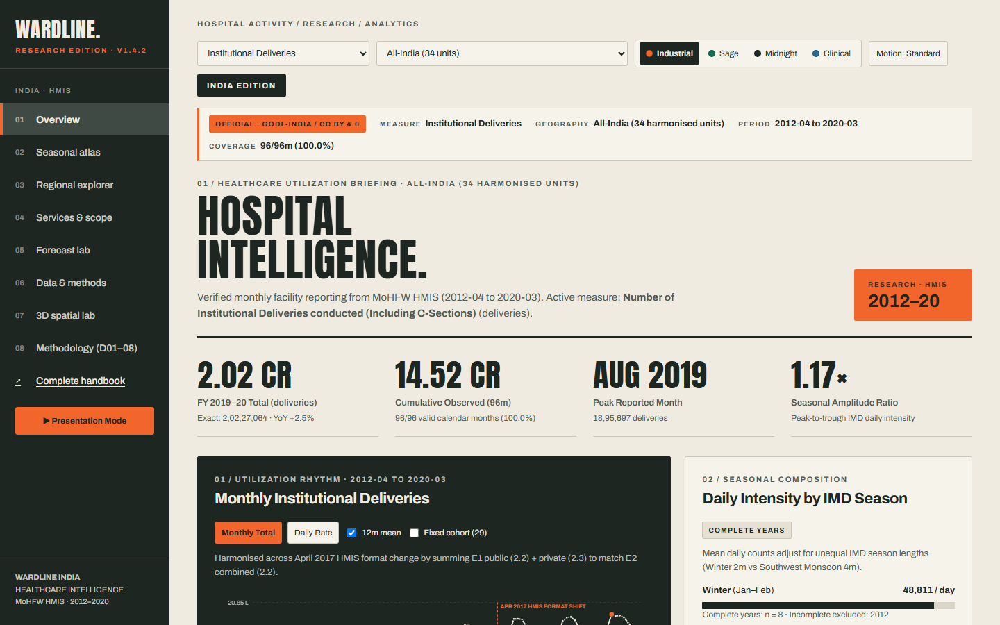

# WARDLINE INDIA

An interactive research application for historical healthcare service utilization in India. Explore seasonal patterns and regional coverage, inspect retrospective forecasts, or follow a guided presentation with the same data used in the analytical views.



## Explore the project

- **Explore** uses the dashboard, seasonal atlas, regional explorer, 3D Spatial Lab, Forecast Lab and methodology views.
- **Demonstrate** opens Presentation Mode in the app. It follows the active dataset and works with the keyboard.
- **Learn** opens the complete handbook in the app. Its standalone HTML also works offline.
- **Build or download** follows the [development guide](docs/DEVELOPMENT.md) or the [offline instructions](docs/USER_GUIDE.md). Hosted site and release links are pending publication approval.

The official data mode uses a harmonized derivative of Ministry of Health and Family Welfare HMIS reports. It covers **34 reporting units, 96 months and seven service-utilization indicators** from April 2012 through March 2020. The 22,848 cells comprise 22,294 observed, 508 not reported and 46 missing records. All-cause inpatient admissions and patient-level demographics are unavailable in this derivative.

## Run from source

Use Python 3.10+ and Node.js 24. Install the pinned dependencies in a virtual environment and acquire the upstream assets before building. Run from the repository root.

```sh
python -m pip install -r requirements.txt
python -m pipeline acquire
python -m pipeline all
npm --prefix frontend ci --no-audit --no-fund
python scripts/prepare_site.py
npm --prefix frontend run build
npm --prefix frontend run preview -- --host 127.0.0.1
```

Open the IPv4 URL printed by Vite. The [data sources](docs/DATA_SOURCES.md) describe required acquisition, checksums and terms. The [testing guide](docs/TESTING.md) covers data reconciliation, forecasting, browser and handbook checks.

## Research and technology

Python, pandas, NumPy and SciPy produce a validated static JSON bundle. React and TypeScript render the dashboard and SVG charts. Three.js scenes load when requested. The app has no server-side data API. The browser parses CSV imports locally and keeps them separate from the historical HMIS dataset. [Architecture](docs/ARCHITECTURE.md) · [Methodology](docs/METHODOLOGY.md) · [Data dictionary](docs/DATA_DICTIONARY.md) · [Limitations](docs/LIMITATIONS.md)

Cite WARDLINE INDIA and the original data producers when using the software or results. [Citation metadata](CITATION.cff) · [Software license text](LICENSE) · [Third-party notices](THIRD_PARTY_NOTICES.md)

The owner confirmed continued MIT terms for project-owned code, subject to ownership and third-party notices. HMIS data and fonts retain their separate terms. The academic project used AI assistance for implementation, drafting and verification. No university or faculty endorsement is asserted.
